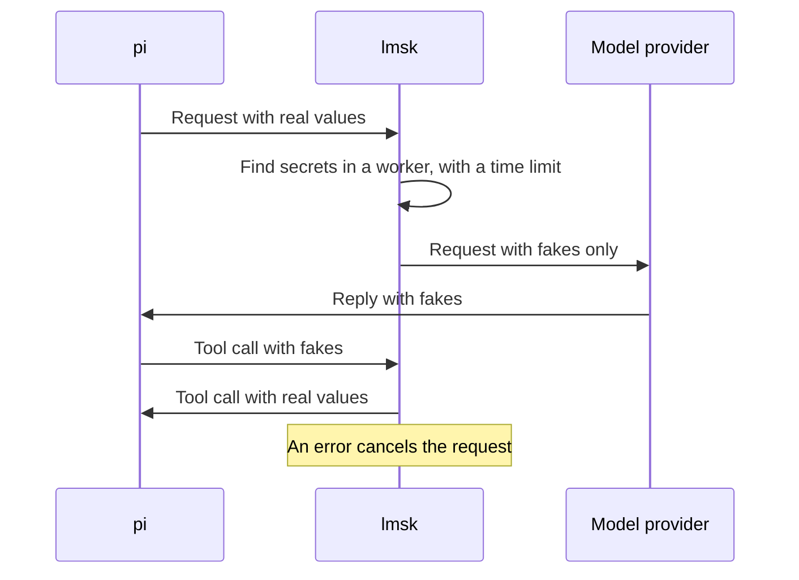

<div align="center">

<h1>
  <picture>
    <source media="(prefers-color-scheme: dark)" srcset="docs/brand/logo-dark.svg">
    
  </picture>
</h1>

**Use AI on your code. Keep your passwords to yourself.**

[Website](https://hugolopes45.github.io/lmsk/) &nbsp;·&nbsp; [Quick start](#quick-start) &nbsp;·&nbsp; [pi](docs/pi.md) &nbsp;·&nbsp; [Claude Code](docs/claude-code.md) &nbsp;·&nbsp; [How it works](#how-it-works) &nbsp;·&nbsp; [FAQ](#faq)

<sub>LLM mask. Local only. No model, no account, no telemetry.</sub>

[](https://github.com/HugoLopes45/lmsk/actions/workflows/ci.yml)

[](LICENSE)

</div>

---

> **Status: early (0.1).** `lmsk` runs as an extension for the [pi](https://github.com/earendil-works/pi) coding agent, and as a local proxy for Claude Code. The Claude Code support is a preview. Configuration and storage can change before 1.0. Test it on your own data before you trust it.

## Why

Your AI assistant reads your `.env`, your logs and your shell output. Each request sends that text to the AI company, where it stays in logs that you do not control. Your passwords, your customer emails and your client's name go with it.

`lmsk` finds these values in each request before it leaves your computer and replaces each one with a fake. When the assistant writes a file or runs a command, `lmsk` puts the real value back, so your project keeps working. The AI company receives only the fakes of the values that `lmsk` finds.

A file on your computer:

```text
DB_PASSWORD=Tr0ub4dor-Horse-42
CONTACT=jane.doe@example.com
```

What the model provider receives. The fakes are random, so yours are different:

```text
DB_PASSWORD=6YPT4SfhOUbx6EEqx5
CONTACT=ptfe.rol@dweervr.xtw
```

- **No action from you.** The default rules work with no configuration.
- **Reversible.** The same real value gets the same fake for the whole session. Built-in tools such as `write` and `bash` get the real value back.
- **Fail closed.** If `lmsk` cannot mask a request safely, it cancels the request. It never sends a partly masked request.

## Features

- **Secrets with a known format.** More than 200 vendor key formats from the [gitleaks](https://github.com/gitleaks/gitleaks) rules, keyed secrets such as `password: ...`, credentials in URLs and headers, emails, phone numbers, IBANs, payment cards and ids. The full list is in [What the default rules detect](docs/CONFIGURATION.md#what-the-default-rules-detect).
- **Secret variable names.** The value of a variable such as `DB_PASSWORD` or `GITHUB_TOKEN` is hidden, also when its format is unknown.
- **Your client and employer names.** A `literal` rule turns `Falcon Industries` into `Client 1`, and the agent writes the real name back to disk. See [Hide who you work for](docs/GUIDE.md#hide-who-you-work-for).
- **Your identity.** Your user name, host name and git identity are masked in each request.
- **The whole request.** The system prompt, tool results, tool descriptions, summaries and model calls outside the conversation.
- **Fakes that fit.** An `opaque` or `shape` fake has the length of its real value, so encoded and sliced copies still restore. That length is visible to the model provider. An email fake keeps the `@`, the dots and the case. A `fixed` fake, such as `Client 1`, does not keep the length of its real value. See [What lmsk does not protect](docs/GUIDE.md#what-lmsk-does-not-protect).
- **Protected paths.** `read`, `grep`, `find` and `ls` refuse `.env`, keys and other secret files, and links to them.
- **Images pass.** Image data is never searched and never blocks a request.
- **`/lmsk reveal` (pi).** Shows the real values behind the fakes in a reply. Only you see the result.

## Works with

| Agent | Status | Install |
|---|---|---|
| Pi | Supported | `pi install npm:@hugolopes45/lmsk-pi`. See [lmsk with pi](docs/pi.md). |
| Claude Code | Preview | `npm install -g @hugolopes45/lmsk`, then start it with `lmsk claude`. See [lmsk with Claude Code](docs/claude-code.md). |

## Quick start

With pi:

1. Install [pi](https://github.com/earendil-works/pi).
2. Install `lmsk`:

   ```bash
   pi install npm:@hugolopes45/lmsk-pi
   ```

3. Start pi, or type `/reload` in an open pi.

With Claude Code:

1. Install `lmsk`:

   ```bash
   npm install -g @hugolopes45/lmsk
   ```

2. Start Claude Code with `lmsk claude` in place of `claude`.

Then send this message. The key in it is a test value:

```text
Repeat this line exactly: API_KEY=Zq7Kp2Lm9Xw4Rt8Vb3Nc
```

The reply must show a different value after `API_KEY=`. That value is the fake that the provider received.

Next steps:

- How to use it every day: [lmsk with pi](docs/pi.md) or [lmsk with Claude Code](docs/claude-code.md).
- Add your own passwords and client names: [user guide](docs/GUIDE.md#add-your-own-secrets).
- What `lmsk` does not protect: [read this before you use it on real data](docs/GUIDE.md#what-lmsk-does-not-protect).

## How it works



1. pi prepares a request.
2. `lmsk` searches it for secrets in a separate worker, with a time limit. If an error occurs, it cancels the request.
3. The vault gives each real value a fake. The model provider receives only fakes.
4. When the reply calls a built-in tool, `lmsk` puts the real values back into the tool call. Tool results are masked before the model sees them.

## FAQ

**Does my code still go to the model provider?**
Yes. `lmsk` hides secrets, names and ids, not your code. Ask your client if its code may go to the provider.

**Is it a sandbox?**
No. A `bash` command gets the real values it needs, and `lmsk` does not stop a tool from using the network. Use a sandbox as well.

**Where are the real values?**
In the vault, a plain JSON file in `~/.pi/agent/lmsk-vaults/` (pi) or `~/.local/state/lmsk/vaults/` (Claude Code). Only your user account can read it (mode 0600). It is not encrypted, so exclude it from cloud backups.

**Why did pi stop my request?**
`lmsk` could not mask it safely. pi shows a message such as `lmsk: SCAN_TIMEOUT.` [Troubleshooting](docs/TROUBLESHOOTING.md) explains each code and what to do.

**Can the model get a secret anyway?**
Yes, in some cases. Detection uses patterns, so a short password with no key name is not found. A model can also change a fake before it uses it. Read [What lmsk does not protect](docs/GUIDE.md#what-lmsk-does-not-protect).

## Privacy

`lmsk` uses no model. It has no account and no telemetry. The pi extension makes no network connections. The proxy for Claude Code connects only to the provider address of the agent. With pi, the vault and the configuration stay in `~/.pi/agent/`. With Claude Code, they stay in `~/.config/lmsk/` and `~/.local/state/lmsk/`.

## Contributing

Read [CONTRIBUTING.md](CONTRIBUTING.md). Report security problems as described in [SECURITY.md](SECURITY.md). Never report them in a public issue.

## License

[MIT](LICENSE). The vendor key rules come from [gitleaks](https://github.com/gitleaks/gitleaks), MIT License, Copyright (c) 2019 Zachary Rice.
